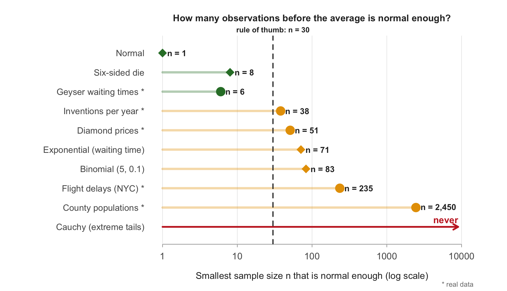

# How Fast Does Normal Happen?

**Statistics classes say 30 data points are enough for an average to behave like a bell curve. I tested that rule. Depending on the data it took anywhere from 8 to 2,450 values, and for one kind of data no sample size worked.**

**[Visual story](https://jamv8.github.io/how-fast-does-normal-happen/)** (start here, no statistics background needed)
&nbsp;·&nbsp; **[Play mode](https://jamv8.github.io/how-fast-does-normal-happen/play.html)**
&nbsp;·&nbsp; **[Lab](https://jamv8.github.io/how-fast-does-normal-happen/simulator.html)**
&nbsp;·&nbsp; **[Full report](https://jamv8.github.io/how-fast-does-normal-happen/report.html)**



---

## In plain words

### What goes wrong with 30 flights

Say you want the average arrival delay at New York's airports. You take 30 random flights, average their delays,
and add the usual "95% range" around that average, the way a statistics class teaches. That range is supposed to
contain the true average 95 times out of 100.

I ran that exact procedure 100,000 times on the real 2013 flight records. The range caught the true average only
**89.8%** of the time. When it missed, it almost always missed low: in **9.8%** of tries the whole range sat below the
real delay, four times the 2.5% the method promises. For county populations it was worse: the range was right only
**71.7%** of the time.

The textbook range relies on the average behaving like a **bell curve**, and the rule of thumb says 30 data points
are enough for that. With lopsided data like delays, prices or populations, they aren't, and the range itself gives
no sign that it's off.

### What I investigated

**How much data does an average need before it really behaves like a bell curve?** Is 30 always enough? Does it
depend on the kind of data? ("How fast" in the title means *how many data points*, not how much time.)

A few words used below:

| Word | Meaning |
|---|---|
| **Bell curve** (statisticians call it the **normal** distribution) | the symmetric hill shape: most values near the middle, fewer and fewer farther out |
| **Sample** | a handful of data points picked at random, like the 1,000 people in a poll |
| **n** | how many data points are in one sample |
| **Central Limit Theorem** | the rule that averages of random samples form a bell curve once n is large enough |
| **Lopsided** (statisticians say **skewed**) | most values are small but a few are huge, like incomes or waiting times |

### How I investigated it

You can't answer this question with one sample, so I used a computer to **simulate** it:

1. Take a kind of data, for example waiting times at a counter.
2. Pick **n** values at random and average them. That is one "study".
3. Repeat the study **100,000 times** and look at the shape of all 100,000 averages.
4. Check whether that shape is close enough to a bell curve, using four tests: *not lopsided*, *not too many
   far-out averages*, *matches the bell outline closely*, and *a "95%" range really catches 95%*.
5. Do this for many values of n, and record the **smallest n** that passes every test.

I did this for **five computer-generated data types** (data that are already bell-shaped, dice rolls, waiting times
for the next customer, counts of rare events, and "extreme-outlier" data) and **five real datasets** (time between
eruptions of the Old Faithful geyser, inventions per year, diamond prices, flight delays at New York airports, and
county populations).

### What I found

1. No single number works. Depending on the data, the answer ranged from **1** (data that are already bell-shaped)
   to **2,450**.
2. Dice rolls needed only **8** values per study, and the time between Old Faithful eruptions only **6**. For data
   that are roughly symmetric, 30 is more than enough.
3. Lopsided data needed far more: waiting times for the next customer **71**, diamond prices **51**, flight delays
   **235**, and county populations **2,450**. A rule of thumb based on skewness (a measure of how lopsided data are)
   came close; for flight delays it predicted 222 and the simulation found 235.
4. For "extreme-outlier" data (statisticians call it the Cauchy distribution), averaging 5,000 values was no better
   than looking at one. No sample size works there.
5. The rule of 30 failed for 4 of my 5 real datasets, including prices, delays and populations, which people analyze
   all the time.
6. In practice, the usual 95% range built from 30 flights missed the true average delay 10.2% of the time, almost
   always on the low side. With 235 flights it missed 5.9%.

So before trusting a "± something" built on an average, check how lopsided the data are. Lopsided data need a lot more
than 30 values.

---

## For statisticians: the details

### Final table

| Population | My prediction | Smallest n (main standard) | Strict / lenient | Skewness at chosen n | Key observation |
|---|---:|---:|---:|---:|---|
| [Standard normal](https://jamv8.github.io/how-fast-does-normal-happen/analysis/01_normal.html) | 1 | **1** | 1 / 1 | −0.008 | Control case: normal at every n |
| [Six-sided die](https://jamv8.github.io/how-fast-does-normal-happen/analysis/02_die.html) | 15 | **8** | 38 / 3 | −0.014 | Symmetric; only the flat, discrete shape had to fade |
| [Exponential (λ = 1)](https://jamv8.github.io/how-fast-does-normal-happen/analysis/03_exponential.html) | 45 | **71** | 600 / 20 | 0.243 | Skewness is the bottleneck; theory predicts 64 |
| [Binomial (5, 0.1)](https://jamv8.github.io/how-fast-does-normal-happen/analysis/04_binomial.html) | 100 | **83** | 900 / 20 | 0.140 | Skewness passes at 30; discreteness sets the answer |
| [Cauchy (0, 1)](https://jamv8.github.io/how-fast-does-normal-happen/analysis/05_cauchy.html) | never | **none** | none / none | undefined | Infinite variance: averaging does not help |

| Real dataset ([extension](https://jamv8.github.io/how-fast-does-normal-happen/analysis/06_real_world_data.html)) | Skewness | Predicted n, (skew/0.25)² | Simulated n | n = 30 enough? |
|---|---:|---:|---:|:---:|
| Old Faithful waiting times | −0.42 | 3 | **6** | yes |
| Great inventions per year | 1.23 | 25 | **38** | no |
| Diamond prices | 1.62 | 42 | **51** | no |
| NYC flight arrival delays | 3.72 | 222 | **235** | no |
| Midwest county populations | 12.15 | 2,362 | **2,450** | no |

### Conclusions

- **No universal n.** Symmetric populations need fewer than 30, skewed ones more, and the Cauchy no finite n.
- **Skewness predicts the threshold.** The skewness of the mean decays as γ/√n, so the threshold is n ≈ (γ / 0.25)²
  (64 predicted vs. 71 simulated for the exponential).
- **Discreteness adds delay.** The binomial passed the skewness check by n = 30, but its lattice of possible means
  kept the Q-Q correlation and tail rates off until n = 83.
- **Infinite variance breaks the theorem.** The mean of n standard Cauchy values is again standard Cauchy; the
  interquartile range stayed at 2.0 from n = 1 to n = 5,000.
- **σ/√n held at every n** for every finite-variance population. The spread converges long before the shape.
- **n = 30 matches only a lenient definition of normality**, one that allows one-sided error rates of a 95% interval
  to be off by a factor of 1.5–2.5.

### The "normal enough" standard

The sample mean is normal enough at n when all four checks pass and keep passing for every larger n tested:

| Check | Pass zone | Purpose |
|---|---|---|
| Skewness | between −0.25 and 0.25 | not lopsided |
| Excess kurtosis | between −0.5 and 0.5 | no surplus of extreme values |
| Q-Q correlation | ≥ 0.998 | straight normal Q-Q plot |
| Tails | 1.75%–3.25% beyond ±1.96 SE on **each** side | 95% intervals stay honest |

Each threshold is about ten times the Monte Carlo noise and keeps each tail of a 95% interval within 0.75 percentage
points of 2.5%. Calibration is on the [Method](https://jamv8.github.io/how-fast-does-normal-happen/methods.html) page;
results are also reported under a strict (|skew| ≤ 0.1) and a lenient (≤ 0.5) standard.

### Method

- **Monte Carlo:** for each n, B = 100,000 samples of size n and their means. B sets precision; n is the quantity studied.
- **Search:** a coarse grid of n, then every n between the last failing and the first passing grid value.
- **Reproducibility:** seed 9426 (last four digits of my student ID), set immediately before each n. Rerunning the
  exponential analysis with seed 2026 changed the exact numbers (n = 69 instead of 71) but not the conclusion.
- **One codebase:** every population is simulated and judged by the same functions in [`R/clt_functions.R`](R/clt_functions.R).

### Repository structure

```
├── index.html                Visual story (home page): scroll-driven particle animation
├── play.html                 Play mode: dice, the Average Machine, a race to the bell curve, polls
├── simulator.qmd             Lab: detailed simulator with all four checks
├── report.qmd                Findings: cross-population summary and research questions
├── methods.qmd               Simulation design and calibration of the standard
├── analysis/
│   ├── 01_normal.qmd         One analysis per population: population, prediction,
│   ├── 02_die.qmd              sample sizes, results, chosen n, evidence,
│   ├── 03_exponential.qmd      what surprised me (+ reproducibility experiment in 03)
│   ├── 04_binomial.qmd
│   ├── 05_cauchy.qmd
│   └── 06_real_world_data.qmd  Extension: rivers, a poll, five real datasets
├── R/
│   ├── clt_functions.R       Shared simulation, diagnostics and plotting code
│   └── export_site_data.R    Exports results to JSON for the website, draws the README figure
├── results/                  Saved results for every population (CSV)
├── assets/                   Website styles, scripts (story.js, play.js, simulator.js) and data
├── docs/                     Rendered website (GitHub Pages)
└── AI_prompts.md             Log of key AI prompts and validation
```

### Reproduce

Requirements: R (≥ 4.3) and Quarto (bundled with RStudio). R packages: `knitr`, `rmarkdown`, `ggplot2`,
`nycflights13`, `jsonlite`.

```bash
quarto render                     # runs every simulation and builds the site into docs/
Rscript R/export_site_data.R      # refreshes the website data and the README figure
```

Results are cached by Quarto's `freeze` (`_freeze/`). Delete that folder to recompute everything from scratch.

### Use of AI

I used an AI assistant for writing R code, building the website, and editing my written explanations. The decisions
(the definition of "normal enough", the predictions, the design choices and the interpretation) are mine. The key
prompts, what I questioned, and how I validated the code are documented in [AI_prompts.md](AI_prompts.md).

---

*MATH 167R · Project 1.*
